# TrustGate 테스트 가이드 (처음 해보는 분을 위한 안내서)

이 문서는 프로그래밍이나 보안을 전혀 몰라도 TrustGate를 직접 실행하고, 기능이 제대로 동작하는지 하나씩 확인할 수 있도록 만든 안내서입니다.
각 테스트마다 **무엇을 하는지(따라 하기)**, **무슨 일이 일어난 건지(원리)**, **왜 필요한지(목적)** 를 함께 설명합니다.

> 걸리는 시간: 준비 20~40분(처음 한 번, 대부분 다운로드 시간) + 테스트 30분 정도
> 필요한 것: Windows 10/11 PC, 인터넷. 휴대폰 인증 앱은 있으면 좋지만 없어도 됩니다.

---

## 목차

0. [TrustGate가 뭔가요? (5분 개념 설명)](#0-trustgate가-뭔가요)
1. [준비하기: Docker 설치와 실행](#1-준비하기)
2. [테스트 1. 첫 로그인과 OTP(2차 인증) 등록](#테스트-1-첫-로그인과-otp-등록)
3. [테스트 2. SSO: 한 번 로그인으로 다른 서비스까지](#테스트-2-sso-한-번-로그인으로-다른-서비스까지)
4. [테스트 3. 통합 로그아웃](#테스트-3-통합-로그아웃)
5. [테스트 4. 같은 OTP 코드 두 번 쓰기 (재사용 차단)](#테스트-4-같은-otp-코드-두-번-쓰기)
6. [테스트 5. 비밀번호 5번 틀리기 (계정 잠금)](#테스트-5-비밀번호-5번-틀리기)
7. [테스트 6. 관리자 콘솔: 암호화된 개인정보 보기](#테스트-6-관리자-콘솔-암호화된-개인정보-보기)
8. [테스트 7. 키 교체와 재암호화](#테스트-7-키-교체와-재암호화)
9. [테스트 8. 해킹 흉내 내기: 주소 조작과 권한 없는 접근](#테스트-8-해킹-흉내-내기)
10. [테스트 9. 데이터베이스를 직접 열어 보기](#테스트-9-데이터베이스를-직접-열어-보기)
11. [테스트 10. 자동 테스트 한 번에 돌리기 (선택)](#테스트-10-자동-테스트-한-번에-돌리기)
12. [문제가 생겼을 때](#문제가-생겼을-때)
13. [끝내기와 처음부터 다시 하기](#끝내기와-처음부터-다시-하기)
14. [용어 사전](#용어-사전)

---

## 0. TrustGate가 뭔가요?

회사 건물을 떠올려 보세요. 건물마다 따로 출입 신청을 하는 대신, **안내 데스크에서 신분 확인을 한 번 받고 출입증을 받으면** 여러 건물을 자유롭게 드나들 수 있습니다. TrustGate는 이것을 웹사이트에서 하는 프로그램입니다.

| 회사 건물 비유 | TrustGate에서는 | 주소 |
|---|---|---|
| 안내 데스크 | **IdP**(통합인증 서버). 아이디·비밀번호와 OTP를 확인합니다 | `http://localhost:8080/idp` |
| 건물 A | **사내 포털** (로그인이 필요한 서비스) | `http://localhost:8080/portal` |
| 건물 B | **웹메일** (로그인이 필요한 또 다른 서비스) | `http://localhost:8080/mail` |
| 출입증 | **ID 토큰**. 안내 데스크가 위조할 수 없게 서명한 "이 사람은 user1입니다" 증명서 | (화면에서 볼 수 있음) |
| 출입 기록부 | **감사 로그** | 관리자 콘솔 |
| 금고 | 주민등록번호 같은 개인정보를 **암호화**해서 넣어 둔 데이터베이스(Oracle) | |

이 가이드에서는 세 가지를 확인합니다.

1. **2차 인증(OTP)**: 비밀번호를 도둑맞아도 휴대폰이 없으면 로그인할 수 없는지
2. **통합인증(SSO)**: 한 번 로그인하면 다른 서비스는 다시 로그인하지 않는지, 한 번 로그아웃하면 모두 로그아웃되는지
3. **DB 암호화**: 데이터베이스를 누가 통째로 가져가도 주민등록번호를 읽을 수 없는지

> 이 프로그램은 내 PC 안에서만 돌아가는 연습용 환경입니다. 데모 계정의 주민등록번호·전화번호는 모두 지어낸 값이고, 바깥 인터넷에서는 접속할 수 없습니다(127.0.0.1에만 열림).

---

## 1. 준비하기

### 1-1. Docker Desktop 설치

**Docker**는 "프로그램을 실행 환경째로 상자에 담아 어느 PC에서나 똑같이 돌리게 해 주는 도구"입니다. TrustGate는 웹 서버(Tomcat)와 데이터베이스(Oracle)가 필요한데, Docker가 있으면 이것들을 하나하나 설치하지 않아도 됩니다.

1. https://www.docker.com/products/docker-desktop/ 에서 **Download for Windows**를 눌러 설치합니다.
2. 설치 중 "WSL 2 사용" 옵션이 나오면 체크된 그대로 둡니다.
3. 설치가 끝나면 PC를 다시 시작합니다.
4. 시작 메뉴에서 **Docker Desktop**을 실행합니다. 처음에는 약관 동의 화면이 나올 수 있습니다. 로그인은 하지 않아도 됩니다(Skip 가능).
5. Docker Desktop 창 왼쪽 아래가 **초록색(Engine running)** 이 되면 준비 완료입니다.

> Docker Desktop은 테스트하는 동안 계속 켜 두어야 합니다. 창을 닫아도 작업 표시줄 오른쪽 아래(고래 아이콘)에서 계속 돌아갑니다.

### 1-2. TrustGate 내려받기

둘 중 편한 방법을 고르세요.

- **방법 A (쉬움)**: https://github.com/LEntropy/TrustGate 에 들어가 초록색 **Code** 버튼 → **Download ZIP**을 누르고, 받은 파일을 원하는 곳(예: 바탕화면)에 압축 해제합니다. `TrustGate-main` 폴더가 생깁니다.
- **방법 B (Git이 있다면)**: `git clone https://github.com/LEntropy/TrustGate.git`

### 1-3. 폴더에서 PowerShell 열기

명령어를 입력하는 창(PowerShell)을 TrustGate 폴더에서 엽니다.

1. 파일 탐색기에서 `TrustGate-main`(또는 `TrustGate`) 폴더를 엽니다. 안에 `docker-compose.yml` 파일이 보이면 맞는 폴더입니다.
2. 탐색기 위쪽 **주소창**을 클릭하고, 적힌 내용을 지운 뒤 `powershell`이라고 입력하고 Enter를 누릅니다.
3. 파란(또는 검은) 창이 열리고 `PS C:\...\TrustGate-main>`처럼 폴더 경로가 보이면 성공입니다.

### 1-4. 실행하기

PowerShell 창에 아래 명령을 그대로 입력하고 Enter를 누릅니다.

```powershell
docker compose up -d --build
```

- **무슨 일이 일어나나요?** Docker가 ① Oracle 데이터베이스, ② Java 프로그램을 빌드할 도구(Maven), ③ 웹 서버(Tomcat) 이미지를 내려받고, TrustGate 코드를 빌드해서 두 개의 "컨테이너(상자)"로 실행합니다.
- **처음 한 번은 오래 걸립니다.** Oracle 이미지가 크기 때문에(설치 후 약 6GB) 인터넷 속도에 따라 10~30분 걸릴 수 있습니다. 두 번째부터는 1분 안에 켜집니다.
- 마지막에 아래처럼 `Started`와 `Healthy`가 보이면 실행된 것입니다.

```
 ✔ Container trustgate-oracle-1 Healthy
 ✔ Container trustgate-app-1    Started
```

### 1-5. 접속 확인

인터넷 브라우저(Chrome, Edge 등)에서 **http://localhost:8080** 을 엽니다.

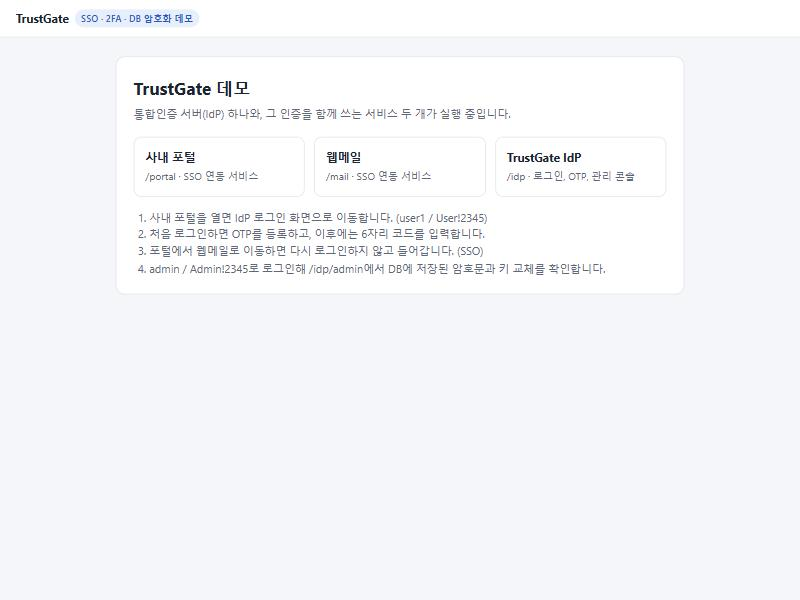

이 화면이 보이면 준비가 끝났습니다. 오류 화면이 나오면 서버가 아직 켜지는 중이니 30초~1분 뒤 새로고침(F5)해 보세요.

> **localhost**는 "지금 쓰고 있는 이 PC"를 뜻하는 주소이고, **8080**은 그 PC 안에서 TrustGate가 쓰는 문 번호(포트)입니다.

### 1-6. (선택) 휴대폰 인증 앱 설치

진짜 2차 인증처럼 해 보고 싶다면 휴대폰에 **Google Authenticator** 또는 **Microsoft Authenticator**를 설치해 두세요(무료).
앱이 없어도 괜찮습니다. 이 데모는 "데모 모드"라서 화면에 지금 입력할 코드를 함께 보여 줍니다.

### 데모 계정

| 아이디 | 비밀번호 | 역할 |
|---|---|---|
| `user1` | `User!2345` | 일반 사용자 (홍길동) |
| `user2` | `User!2345` | 일반 사용자 (김영희) |
| `admin` | `Admin!2345` | 관리자 |

---

## 테스트 1. 첫 로그인과 OTP 등록

### 따라 하기

1. 시작 화면에서 **사내 포털**을 누릅니다.
2. 사내 포털 대신 **TrustGate 로그인 화면**이 나옵니다. 주소창을 보면 `localhost:8080/idp/login`으로 바뀌어 있습니다.

   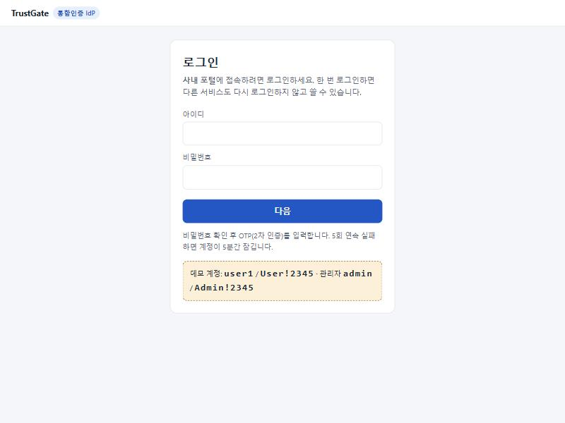

3. 아이디 `user1`, 비밀번호 `User!2345`를 입력하고 **다음**을 누릅니다.
4. **OTP 등록** 화면이 나옵니다. user1은 아직 2차 인증을 등록한 적이 없기 때문입니다.

   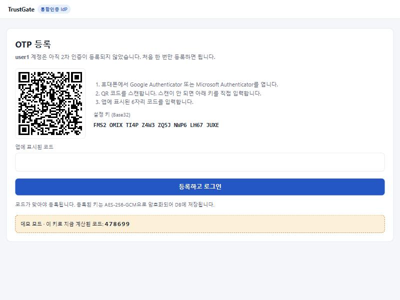

5. 코드를 입력합니다.
   - **휴대폰 앱이 있다면**: 앱에서 `+` → **QR 코드 스캔**을 누르고 화면의 QR을 비춥니다. 앱에 `TrustGate (user1)`과 6자리 숫자가 생기면, 그 숫자를 입력합니다.
   - **앱이 없다면**: 화면 아래 노란 상자(데모 모드)의 6자리 숫자를 입력합니다.
6. 일부러 틀린 숫자(예: `123456`)를 먼저 넣어 보세요. "코드가 맞지 않습니다"라는 빨간 안내가 나오고 등록되지 않습니다.
7. 맞는 숫자를 넣고 **등록하고 로그인**을 누르면 **사내 포털**로 돌아옵니다. "홍길동님, 사내 포털에 오신 것을 환영합니다"가 보이면 성공입니다.

   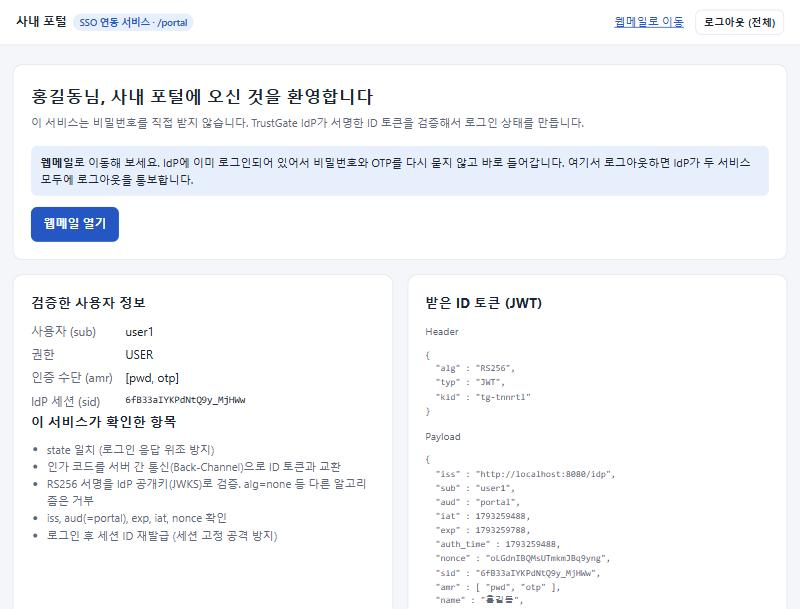

> 숫자는 30초마다 바뀝니다. 입력하는 사이 바뀌었다면 새 숫자를 넣으면 됩니다. 바로 직전 숫자도 30초 정도는 받아 줍니다.

### 확인할 것

- [ ] 사내 포털을 눌렀는데 IdP 로그인 화면으로 이동했다
- [ ] 틀린 코드로는 등록되지 않았다
- [ ] 맞는 코드를 넣자 사내 포털에 들어갔다

### 무슨 일이 일어난 건가요? (원리)

**OTP(One-Time Password, 일회용 비밀번호)** 는 다음과 같이 만들어집니다.

```
   [서버와 휴대폰이 함께 가진 비밀키]  +  [현재 시각을 30초 단위로 자른 값]
                     └──────── 수학 계산(HMAC-SHA1) ────────┘
                                      ↓
                                6자리 숫자 (예: 095381)
```

- QR 코드 안에는 **비밀키**가 들어 있습니다. 스캔하는 순간 휴대폰과 서버가 같은 비밀키를 갖게 됩니다.
- 그다음부터는 둘 다 **같은 비밀키와 같은 시각**으로 계산하므로 **인터넷 연결 없이도** 같은 숫자가 나옵니다. 휴대폰을 비행기 모드로 해도 숫자가 나오는 이유입니다.
- 이 방식은 국제 표준(RFC 6238, TOTP)이라서 Google·Microsoft 앱 어디서나 동작합니다.
- 등록할 때 코드를 한 번 맞혀야 하는 이유는 "QR이 제대로 스캔됐는지" 확인하기 위해서입니다. 확인이 끝나면 비밀키는 **암호화해서** 데이터베이스에 저장됩니다.

### 왜 필요한가요? (목적)

비밀번호는 유출되기 쉽습니다(여러 사이트에 같은 비밀번호 사용, 피싱, 해킹 사고 등). OTP를 함께 쓰면 범인이 비밀번호를 알아도 **내 휴대폰이 없으면 로그인할 수 없습니다.** "아는 것(비밀번호) + 가진 것(휴대폰)" 두 가지를 확인한다고 해서 **2단계 인증**이라고 부릅니다.

> 실제 서비스라면 노란 데모 상자는 절대 있으면 안 됩니다. 테스트를 쉽게 하려고만 켜 둔 기능이며, `TG_DEMO_MODE=false`로 끌 수 있습니다.

---

## 테스트 2. SSO: 한 번 로그인으로 다른 서비스까지

### 따라 하기

1. 사내 포털 화면에서 파란 **웹메일 열기** 버튼을 누릅니다.
2. 로그인 화면이나 OTP 화면 **없이** 곧바로 "홍길동님, 웹메일에 오신 것을 환영합니다"가 나옵니다.

   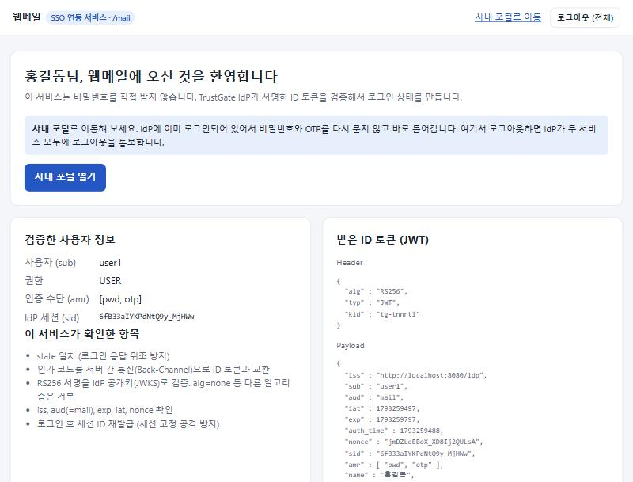

3. 두 화면(포털, 웹메일)의 왼쪽 아래 **IdP 세션 (sid)** 값을 비교해 보세요. 똑같습니다.
4. 오른쪽 **받은 ID 토큰** 상자의 `"aud"` 값을 비교해 보세요. 포털에서는 `"portal"`, 웹메일에서는 `"mail"`입니다.
5. 주소창에 `http://localhost:8080/idp/` 를 입력해 IdP의 **내 계정** 화면을 엽니다. 두 서비스 모두 "이 세션으로 접속함"으로 표시됩니다. 주민등록번호는 `900101-1******`처럼 가려져 보입니다.

   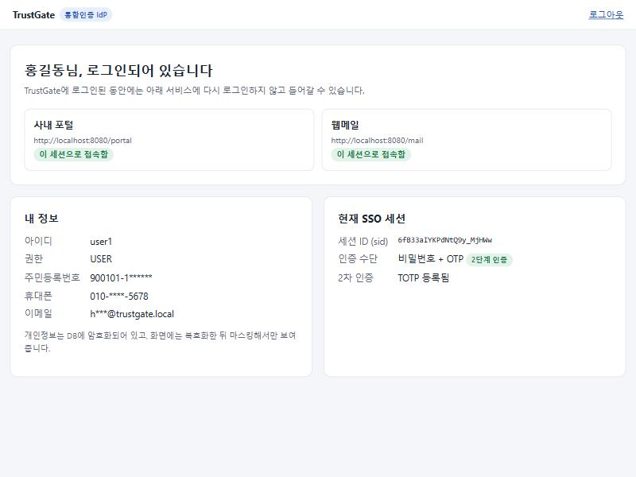

### 확인할 것

- [ ] 웹메일에 비밀번호·OTP 없이 들어갔다
- [ ] 두 서비스의 sid가 같다
- [ ] aud가 각각 portal, mail로 다르다

### 무슨 일이 일어난 건가요? (원리)

화면에는 안 보이지만 웹메일을 누른 순간 아래 일이 1초 안에 일어났습니다.

```
 웹메일: "로그인 안 된 사람이네. 안내 데스크(IdP)로 보내자."
   → IdP: "이 브라우저는 아까 비밀번호+OTP까지 확인했던 사람이다."
   → IdP: 웹메일에게 한 번만 쓸 수 있는 '교환권(인가 코드)'을 들려 보냄
   → 웹메일: 교환권을 IdP에 직접 보내고(브라우저를 거치지 않음) '출입증(ID 토큰)'을 받음
   → 웹메일: 출입증의 서명이 진짜인지, 웹메일용(aud=mail)이 맞는지, 만료되지 않았는지 확인
   → 로그인 완료
```

- **ID 토큰**은 IdP가 **전자서명(RS256)** 한 증명서입니다. 웹메일은 IdP가 공개한 열쇠(공개키)로 서명을 확인합니다. 내용을 한 글자라도 고치면 서명 확인에 실패합니다.
- **aud(audience)** 는 "이 출입증을 어느 서비스용으로 발급했는지"입니다. 포털용 출입증을 훔쳐서 웹메일에 내밀어도 거부됩니다.
- **sid**는 IdP에서의 로그인 묶음 번호입니다. 같은 sid라는 것은 "같은 한 번의 로그인"으로 두 서비스에 들어갔다는 뜻입니다.
- 서비스(포털·웹메일)는 **비밀번호를 한 번도 받지 않습니다.** 비밀번호는 IdP만 다룹니다.

### 왜 필요한가요? (목적)

회사에서 그룹웨어, 메일, 결재, 인사 시스템마다 따로 로그인하면 불편하고, 사람들은 결국 쉬운 비밀번호를 여러 곳에 똑같이 쓰게 됩니다. SSO를 쓰면 **로그인은 한 곳(IdP)에서만, 그 한 곳만 철저하게 지키면 되므로** 편리하면서 더 안전합니다. 2차 인증, 계정 잠금, 감사 기록도 IdP 한 곳에만 만들면 모든 서비스에 적용됩니다.

---

## 테스트 3. 통합 로그아웃

### 따라 하기

1. 웹메일 화면(`http://localhost:8080/mail/`) 오른쪽 위 **로그아웃 (전체)** 를 누릅니다.
2. "로그아웃했습니다 … 사내 포털도 IdP의 통보를 받아 함께 로그아웃되었습니다"가 나옵니다.

   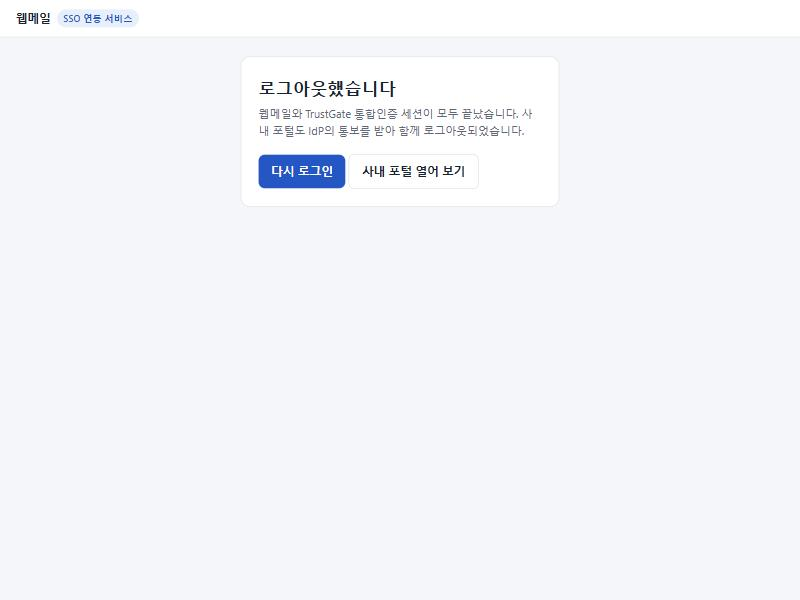

3. **사내 포털 열어 보기**를 누릅니다. 포털에서는 로그아웃 버튼을 누른 적이 없는데도 **로그인 화면**이 나옵니다.

### 확인할 것

- [ ] 웹메일에서 로그아웃했더니 사내 포털도 로그인이 풀렸다

### 무슨 일이 일어난 건가요? (원리)

웹메일이 IdP에 로그아웃을 요청하면, IdP는 이 로그인(sid)으로 출입증을 받아 간 **모든 서비스에 서버끼리 직접 "이 sid는 로그아웃됐다"고 통보**합니다(Back-Channel Logout). 이 통보에도 IdP의 전자서명이 붙어 있어서, 아무나 가짜 통보를 보내 남의 세션을 끊을 수 없습니다.

### 왜 필요한가요? (목적)

PC방이나 공용 PC에서 메일만 로그아웃하고 자리를 떴는데 포털은 로그인된 채로 남아 있다면, 다음 사람이 그 포털을 그대로 쓸 수 있습니다. "한 번 로그인"의 반대인 "한 번 로그아웃"까지 되어야 SSO가 안전합니다.

---

## 테스트 4. 같은 OTP 코드 두 번 쓰기

이 테스트는 **1분 안에** 빠르게 진행해야 합니다. 순서를 먼저 읽고 시작하세요.

### 따라 하기

1. 로그인 화면에서 `user1` / `User!2345`로 로그인합니다.
2. **2차 인증(OTP)** 화면이 나오면(이번에는 등록 화면이 아니라 코드 입력 화면입니다) 앱이나 노란 상자의 숫자를 **메모지에 적고** 입력해서 로그인합니다.

   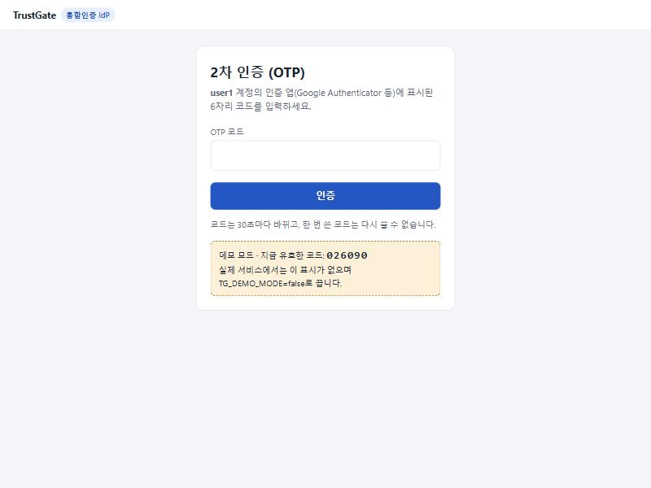

3. 바로 주소창에 `http://localhost:8080/idp/logout` 을 입력해 로그아웃합니다.
4. 다시 `http://localhost:8080/portal/` 로 가서 `user1` / `User!2345`로 로그인합니다.
5. OTP 화면에서 **아까 적어 둔 숫자**를 그대로 입력합니다.
6. "이미 사용된 OTP 코드입니다"라는 안내가 나오고 로그인되지 않습니다.

   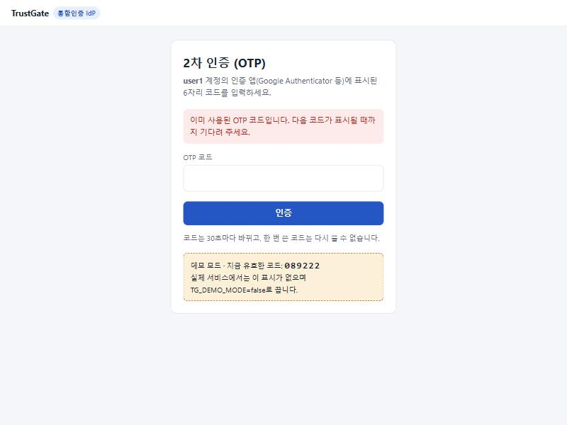

7. 이제 **새 숫자**로 로그인합니다. 숫자는 30초마다 바뀌므로, 지금 보이는 숫자가 아까 쓴 숫자와 같다면 바뀔 때까지(최대 30초) 기다립니다.
   - 휴대폰 앱: 숫자가 바뀌면 새 숫자를 입력합니다.
   - 노란 상자: 상자의 숫자는 화면을 열 때 정해지므로, 30초쯤 기다린 뒤 주소창에 `http://localhost:8080/idp/otp` 를 입력해 화면을 **다시 엽니다.** 그러면 새 숫자가 보입니다. (F5 새로고침은 방금 보낸 코드를 다시 보내려고 하므로 쓰지 마세요.)

   새 숫자를 넣으면 정상적으로 사내 포털에 로그인됩니다.

> 1분이 넘게 지나서 5번을 하면 "OTP 코드가 올바르지 않습니다"가 나올 수 있습니다. 시간이 지나 그 숫자가 만료된 것이고, 이것도 정상 동작입니다.

### 무슨 일이 일어난 건가요? (원리)

서버는 OTP를 확인할 때 "몇 번째 30초 구간의 코드였는지"를 사용자별로 기록합니다. 다음 로그인 때는 **기록된 구간보다 뒤의 코드만** 받습니다. 이 확인은 데이터베이스 명령 하나로 한 번에 처리되기 때문에, 두 사람이 같은 코드를 동시에 넣어도 한 명만 성공합니다.

### 왜 필요한가요? (목적)

누군가 어깨 너머로 OTP 숫자를 보거나, 가짜 사이트(피싱)로 숫자를 가로챘다고 해 봅시다. 숫자는 30~60초 동안 유효하므로, 재사용을 막지 않으면 범인이 그 사이에 같은 숫자로 로그인할 수 있습니다. "한 번 쓴 숫자는 끝"이어야 진짜 **일회용** 비밀번호입니다.

---

## 테스트 5. 비밀번호 5번 틀리기

### 따라 하기

1. 로그아웃(`http://localhost:8080/idp/logout`)한 뒤 로그인 화면(`http://localhost:8080/idp/login`)으로 갑니다.
2. 아이디 `user2`, 비밀번호는 아무렇게나(예: `wrong1`) 입력하고 **다음**을 누릅니다. 이것을 **5번** 반복합니다.
   - 1~4번째: "아이디 또는 비밀번호가 올바르지 않습니다."
   - 5번째: "로그인에 5회 실패하여 계정을 5분간 잠갔습니다."
3. 이제 **올바른 비밀번호** `User!2345`를 넣어도 "계정이 잠겼습니다"가 나옵니다.

   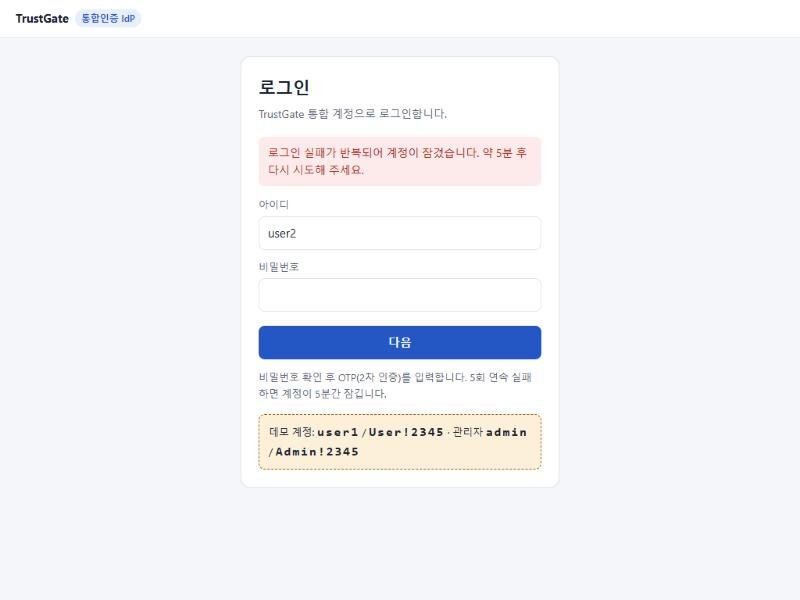

4. 덤으로, 아이디에 존재하지 않는 `nobody`를 넣어 보세요. 틀린 비밀번호와 **똑같은** 문장이 나옵니다.

잠긴 계정은 5분이 지나면 풀리고, 관리자가 바로 풀어 줄 수도 있습니다(테스트 6에서 해 봅니다).

### 왜 필요한가요? (목적)

- **계정 잠금**: 프로그램으로 비밀번호를 수만 번 대입해 보는 공격(무차별 대입)을 막습니다. 5번이면 사람이 오타를 내기에는 충분하고, 기계가 맞히기에는 턱없이 적은 횟수입니다.
- **같은 문장**: "그런 아이디는 없습니다"와 "비밀번호가 틀렸습니다"를 다르게 보여 주면, 범인은 어떤 아이디가 진짜로 있는지 알아낼 수 있습니다. 그래서 일부러 같은 문장을 보여 주고, 응답 시간까지 비슷하게 맞춥니다.

---

## 테스트 6. 관리자 콘솔: 암호화된 개인정보 보기

### 따라 하기

1. 주소창에 `http://localhost:8080/idp/admin` 을 입력합니다. 로그인 화면이 나오면 `admin` / `Admin!2345`로 로그인합니다.
2. admin도 처음이면 OTP 등록 화면이 나옵니다. 테스트 1처럼 등록합니다.
3. **보안 관리 콘솔**이 열립니다.

   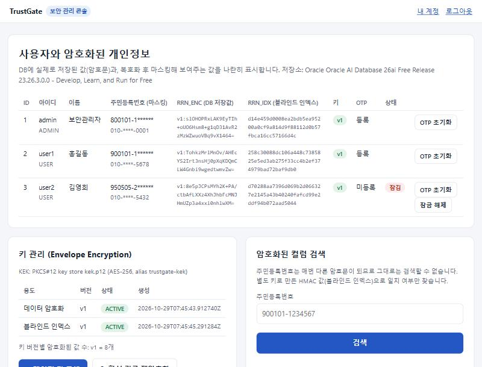

표의 각 칸이 뜻하는 것은 다음과 같습니다.

| 칸 | 뜻 |
|---|---|
| 주민등록번호 (마스킹) | 데이터베이스의 암호문을 풀어서(복호화) 뒷자리를 `*`로 가린 값. 사람이 보는 화면에는 이것만 나갑니다 |
| **RRN_ENC (DB 저장값)** | 데이터베이스에 **실제로 저장된 값**. `v1:` 뒤의 알아볼 수 없는 글자가 암호문입니다 |
| RRN_IDX (블라인드 인덱스) | 암호문 상태로 검색하기 위한 값 (아래 4번에서 설명) |
| 키 | 이 값을 몇 번 열쇠(v1, v2 …)로 잠갔는지 |
| 상태 | 테스트 5에서 잠근 user2가 **잠김**으로 보입니다 |

4. 오른쪽 **암호화된 컬럼 검색**에 `900101-1234567`(user1의 가짜 주민번호)을 넣고 **검색**합니다. "결과: user1 (홍길동)"이 나옵니다.

   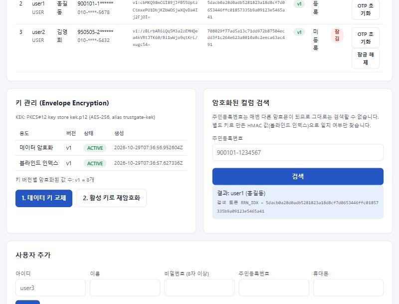

   결과 아래 "검색 토큰" 값을 위 표의 user1 **RRN_IDX** 값과 비교해 보세요. 똑같습니다.
5. 표에서 user2 줄의 **잠금 해제** 버튼을 누릅니다. 위에 "user2 계정 잠금을 해제했습니다"가 나오고 **잠김** 표시가 사라집니다.
6. 페이지 맨 아래 **감사 로그**를 봅니다. 지금까지 한 일이 시간 순서대로 모두 남아 있습니다.

   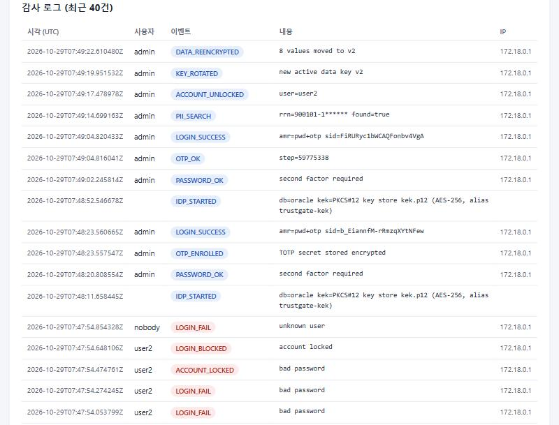

   - user2의 `LOGIN_FAIL` 4번 → `ACCOUNT_LOCKED` → `LOGIN_BLOCKED`
   - admin의 `PII_SEARCH`: 검색한 주민번호도 `900101-1******`처럼 **가려서** 기록됩니다
   - `ACCOUNT_UNLOCKED`: 누가 누구의 잠금을 풀었는지

### 무슨 일이 일어난 건가요? (원리)

- **암호화(AES-256-GCM)**: 주민번호·전화번호·OTP 비밀키는 저장하기 전에 열쇠로 잠급니다. 같은 주민번호도 잠글 때마다 다른 암호문이 됩니다. 그리고 암호문은 **자기 자리(어느 사용자의 어느 칸)에서만** 풀리게 묶여 있어서, A의 암호문을 B의 칸에 몰래 옮겨 넣으면 풀리지 않습니다.
- **블라인드 인덱스**: 매번 다른 암호문이 되니 "이 주민번호를 가진 사람"을 찾을 방법이 없습니다. 그래서 주민번호를 **별도의 열쇠로 한 방향 변환(HMAC)** 한 값을 따로 저장합니다. 같은 주민번호는 항상 같은 값이 되므로 그 값으로 찾을 수 있지만, 그 값에서 주민번호를 되돌려 낼 수는 없습니다. 관리자가 사용자를 추가할 때 "같은 주민번호로 가입된 사용자가 있는지"도 이 방법으로 확인합니다.
- **마스킹**: 풀어낸 값도 화면에는 필요한 만큼만 보여 줍니다.

### 왜 필요한가요? (목적)

해킹이나 백업 파일 유출로 **데이터베이스가 통째로 새어 나가는** 사고는 실제로 자주 일어납니다. 개인정보를 그냥 저장했다면 그대로 피해가 되지만, 암호화해 두었다면 범인이 가져간 것은 알아볼 수 없는 글자뿐입니다. 우리나라 개인정보 보호 법령도 주민등록번호 같은 고유식별정보는 암호화해서 저장하도록 요구합니다.

---

## 테스트 7. 키 교체와 재암호화

관리자 콘솔 가운데 **키 관리** 상자를 봅니다.

### 따라 하기

1. "키 버전별 암호화된 값 수: v1 = 8개"를 확인합니다. (사용자 3명의 주민번호·전화번호 6개 + OTP를 등록한 사람의 비밀키)
2. **1. 데이터 키 교체**를 누릅니다.
   - 표에 `v2 ACTIVE`가 새로 생기고, `v1`은 `RETIRED`(은퇴)가 됩니다.
   - 하지만 값 수는 아직 "v1 = 8개"입니다. 기존 값은 그대로 v1 열쇠로 잠겨 있고, 여전히 잘 풀립니다(위 표의 마스킹 값이 그대로 보임).

   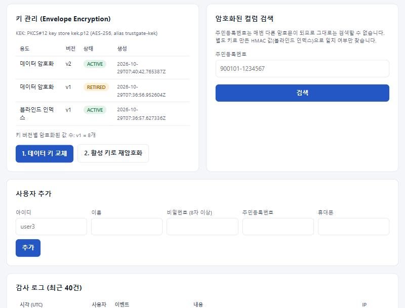

3. **2. 활성 키로 재암호화**를 누릅니다.
   - "암호화된 값 8개를 활성 키 v2로 다시 암호화했습니다"가 나옵니다.
   - 위 표의 RRN_ENC가 `v2:`로 시작하는 **완전히 다른 글자**로 바뀝니다.
   - 반면 RRN_IDX(블라인드 인덱스)는 **그대로**입니다. 검색용 열쇠는 따로 있기 때문입니다.

   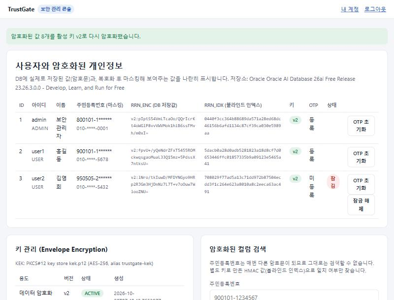

4. 표의 **주민등록번호 (마스킹)** 칸은 여전히 `900101-1******`처럼 정상으로 보입니다. 새 열쇠(v2)로 잠근 값을 문제없이 풀고 있다는 뜻입니다. 나중에 `user1`으로 로그인해 `http://localhost:8080/idp/` 의 **내 정보**를 봐도 똑같이 나옵니다.

### 무슨 일이 일어난 건가요? (원리)

TrustGate는 열쇠를 두 단계로 관리합니다(봉투 암호화, Envelope Encryption).

```
 마스터 열쇠 (KEK)  ── 금고 파일(kek.p12)에 보관. 데이터를 직접 잠그지 않음
    └─ 잠금 ─► 데이터 열쇠 v1, v2 … (DEK)  ── 잠긴 상태로 DB의 TG_KEYS 표에 보관
                  └─ 잠금 ─► 주민번호, 전화번호, OTP 비밀키
```

- 데이터 열쇠는 데이터베이스에 있지만 **마스터 열쇠로 잠긴 채** 있습니다. 그래서 데이터베이스만 훔쳐 가서는 데이터 열쇠도, 개인정보도 열 수 없습니다.
- **키 교체**는 새 데이터 열쇠를 만드는 일이고, **재암호화**는 기존 값을 옛 열쇠로 풀어 새 열쇠로 다시 잠그는 일입니다. 둘을 나눠 두었기 때문에 서비스를 멈추지 않고 열쇠를 바꿀 수 있습니다.
- 실제 회사에서는 마스터 열쇠를 HSM(열쇠 전용 보안 장비)이나 클라우드 KMS에 둡니다. TrustGate는 이 부분을 갈아 끼울 수 있게 분리해 두었습니다.

### 왜 필요한가요? (목적)

열쇠도 오래 쓰면 위험해집니다(퇴사자, 유출 의심, 보안 규정상 주기적 교체 등). 열쇠를 바꿀 수 없는 시스템은 열쇠가 한 번 새면 끝입니다. 주기적으로, 또는 사고가 의심될 때 즉시 열쇠를 바꿀 수 있어야 합니다.

---

## 테스트 8. 해킹 흉내 내기

브라우저 주소창만으로 해 볼 수 있는 공격 두 가지입니다.

### 8-1. 로그인 후 돌아갈 주소를 바꿔치기

아래 주소를 주소창에 **통째로 복사해서** 붙여 넣고 Enter를 누릅니다.

```
http://localhost:8080/idp/authorize?response_type=code&client_id=portal&redirect_uri=http://evil.example/steal&state=test&nonce=test
```

`redirect_uri=http://evil.example/steal` 부분이 "로그인이 끝나면 교환권(인가 코드)을 이 주소로 보내 달라"는 뜻입니다. 범인이 이런 링크를 메일로 보내고, 피해자가 누르면 교환권이 범인 사이트로 간다는 시나리오입니다.

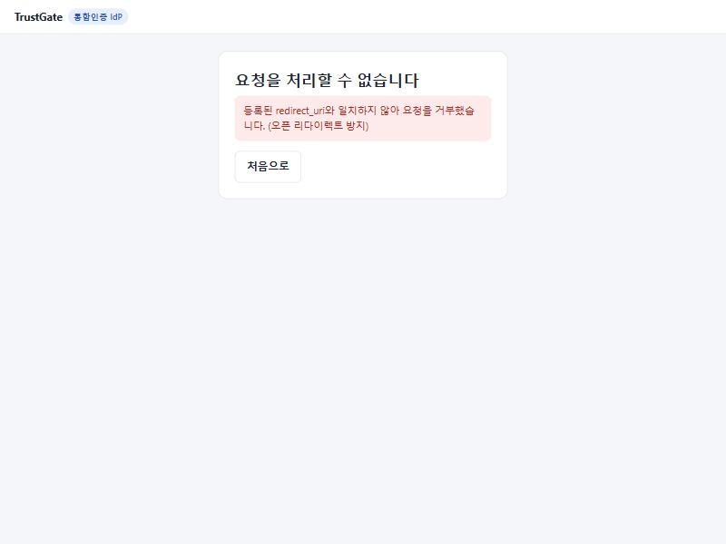

"등록된 redirect_uri와 일치하지 않아 요청을 거부했습니다"가 나오고 어디로도 이동하지 않습니다. **관리자로 로그인된 상태에서 눌러도** 마찬가지입니다. IdP는 서비스마다 미리 등록해 둔 주소와 **한 글자도 다르지 않을 때만** 교환권을 보냅니다.

### 8-2. 일반 사용자가 관리자 페이지 열기

1. 로그아웃한 뒤 `user1`으로 로그인합니다.
2. 주소창에 `http://localhost:8080/idp/admin` 을 직접 입력합니다.
3. "관리자만 접근할 수 있는 페이지입니다"가 나옵니다.

화면에 관리자 메뉴가 안 보이는 것만으로는 부족합니다. 주소를 직접 쳐서 들어오는 경우까지 서버가 매번 **데이터베이스의 권한을 다시 확인**해서 막아야 합니다.

### (더 해 보기) 브라우저 개발자 도구로 쿠키 보기

로그인한 상태에서 F12 → **애플리케이션**(Application) 탭 → 왼쪽 **쿠키** → `http://localhost:8080` 을 누르면 `JSESSIONID` 쿠키가 보입니다. **HttpOnly** 칸에 체크(✓)가 되어 있고 **SameSite**가 `Lax`입니다.
- HttpOnly: 웹페이지에 악성 스크립트가 끼어들어도 이 쿠키를 읽어 가지 못합니다.
- SameSite=Lax: 다른 사이트에서 몰래 보낸 요청에는 이 쿠키가 따라가지 않습니다.

---

## 테스트 9. 데이터베이스를 직접 열어 보기

화면이 아니라 데이터베이스(Oracle)에 정말 암호문만 있는지 직접 확인합니다. PowerShell 창에서 실행합니다.

```powershell
powershell -ExecutionPolicy Bypass -File .\show_db.ps1
```

결과 예시:

```
===== TG_USERS: what is actually stored for each user =====
USERNAME   RRN_ENC                                                   RRN_IDX              OTP_SECRET_ENC
---------- --------------------------------------------------------- -------------------- --------------------
admin      v2:pIptS54VmLTcaOo/QQrIcrKt4oWGlP8vvVWVMok1hiB6ssFMvh/... 0440f3cc364b88689da5 v2:Eud3K+DPSjzIdRdI...
user1      v2:fpvU+/yQeNdrZFxT5455ROMckwqsgaoMuaL33Q15mz+5PdssX7... 5dacb0a28d0adb528182 v2:o9Ec/P47mZd32eGK...
user2      v2:lNro/tkIuwD/MFDYNGyo9HRp2RJGm3HjDnNz7L7T+v7oOuw7Wl... 708029f77ad5a13c71dd

===== TG_KEYS: data keys, stored wrapped by the KEK =====
   VERSION PURPOSE STATUS   WRAPPED_KEY
---------- ------- -------- ------------------------------------------------------------
         1 ENC     RETIRED  9ugqLcZF5AWlqBT4fzZ8Jvu1iOnM8cuYYnzZxKlJxyysSka0/RuVNtGdLQOz
         2 ENC     ACTIVE   l//aBLAm+HI6KQgMpRCutzfEMQ7DDw3MbpF0T0fHwol7vcb6KpSDaVrZoDhj
         1 IDX     ACTIVE   F76yu1XHixpgdaiy8Ck6eWu7jiCCiD71wwPANLzl2mccG+hcMjzXIysuoRoi
```

- 어디에도 `900101`이나 `1234567` 같은 숫자가 없습니다. 데이터베이스 관리자나 침입자가 이 표를 봐도 개인정보를 알 수 없습니다.
- `TG_KEYS`의 열쇠들도 마스터 열쇠로 잠긴 상태라 그대로는 쓸 수 없습니다.
- user2는 OTP를 등록하지 않았으므로 OTP_SECRET_ENC가 비어 있습니다.

> 이 스크립트는 연습 환경의 DB 계정(`trustgate`)으로 접속합니다. 비밀번호는 `docker-compose.yml`에 데모 기본값으로 적혀 있습니다.

---

## 테스트 10. 자동 테스트 한 번에 돌리기

지금까지 손으로 한 확인(그리고 손으로 하기 어려운 확인)을 프로그램이 한 번에 해 주는 기능입니다. **Python 3**이 필요합니다. 없다면 https://www.python.org/downloads/ 에서 설치하고, 설치 첫 화면의 **Add python.exe to PATH**에 꼭 체크하세요.

```powershell
powershell -ExecutionPolicy Bypass -File .\run_tests.ps1
```

1. **[1/3] 단위 테스트 38개**: 암호화·OTP·토큰 같은 부품을 하나씩 시험합니다. 국제 표준 문서에 실린 정답 값(테스트 벡터)과 비교하고, 위조 토큰·변조된 암호문 같은 공격 입력이 거부되는지 확인합니다.
2. **[2/3] 서버 실행**: 이미 켜져 있으면 그대로 씁니다.
3. **[3/3] End-to-End 36개 항목**: 브라우저처럼 동작하는 프로그램이 로그인부터 로그아웃까지 실제로 해 보고, 공격 시나리오(코드 재사용, 위조 토큰, CSRF 등)도 시도합니다.

마지막에 `36/36 checks passed`가 나오고, `test-results\report.html` 파일을 더블클릭하면 결과 보고서를 볼 수 있습니다.

> 자동 테스트는 테스트용 사용자(`e2e…`)를 새로 만들고, 키 교체도 한 번 실행합니다. admin의 OTP를 아직 등록하지 않았다면 자동 테스트가 등록해 버리므로, 그 뒤 휴대폰 앱으로 admin을 쓰려면 관리자 콘솔에서 **OTP 초기화**를 누르세요(데모 모드라면 노란 상자의 코드로 로그인할 수 있습니다).

---

## 문제가 생겼을 때

| 증상 | 해결 방법 |
|---|---|
| `docker`라는 명령을 찾을 수 없다고 나옴 | Docker Desktop이 설치·실행되어 있는지 확인하고, PowerShell 창을 닫았다가 새로 엽니다 |
| `failed to connect to the docker API` | Docker Desktop을 실행하고 초록색(Engine running)이 될 때까지 기다립니다 |
| `port is already allocated` / 8080 관련 오류 | 다른 프로그램이 8080 포트를 쓰고 있습니다. 그 프로그램을 끄고 다시 실행합니다 |
| `docker-compose.yml`을 찾을 수 없다고 나옴 | PowerShell이 TrustGate 폴더에서 열린 게 아닙니다. [1-3](#1-3-폴더에서-powershell-열기)을 다시 합니다 |
| 브라우저에서 "사이트에 연결할 수 없음" | 아직 켜지는 중입니다. 1분 뒤 새로고침합니다. 계속되면 `docker compose ps`로 두 컨테이너가 `Up`인지 확인합니다 |
| OTP 앱의 숫자를 넣어도 계속 틀리다고 나옴 | 휴대폰 시계가 틀려 있으면 숫자가 달라집니다. 휴대폰 설정에서 **날짜와 시간 자동 설정**을 켭니다 |
| "OTP 인증에 5회 실패했습니다" 후 로그인 화면 | 정상 동작입니다. 비밀번호부터 다시 입력합니다 |
| 계정이 잠김 | 5분 기다리거나, admin으로 관리자 콘솔에서 **잠금 해제**를 누릅니다 |
| admin의 OTP를 모름 | 데모 모드의 노란 상자 코드를 쓰거나, 다른 관리자가 **OTP 초기화**를 누릅니다. 전부 초기화하려면 아래 "처음부터 다시 하기" |
| "요청이 만료되었거나 위조되었습니다 (CSRF)" | 로그인 화면을 오래 띄워 두었거나 뒤로 가기로 돌아와 다시 제출한 경우입니다. 새로고침(F5) 후 다시 입력합니다 |
| 그 밖의 오류 | `docker compose logs app` 으로 서버 기록을 확인할 수 있습니다 |

---

## 끝내기와 처음부터 다시 하기

| 하고 싶은 일 | 명령 |
|---|---|
| 잠시 끄기 (데이터는 남음) | `docker compose stop` |
| 다시 켜기 | `docker compose start` |
| 끄고 컨테이너 정리 (데이터는 남음) | `docker compose down` |
| **처음부터 다시** (사용자·OTP 등록·키·감사 로그 모두 삭제) | `docker compose down -v` 후 `docker compose up -d --build` |

`-v`는 데이터 보관함(볼륨)까지 지우라는 뜻입니다. 다시 켜면 데모 계정 3개만 있는 첫 상태로 돌아갑니다.
다 쓴 뒤 디스크 공간을 되찾고 싶다면 Docker Desktop의 **Images** 메뉴에서 `gvenzl/oracle-free`, `tomcat`, `maven`, `trustgate-app` 이미지를 지우면 됩니다.

---

## 용어 사전

| 용어 | 쉬운 설명 |
|---|---|
| **SSO** (Single Sign-On) | 한 번 로그인으로 여러 서비스를 쓰는 방식. 이 가이드의 "출입증" |
| **IdP** (Identity Provider) | 로그인을 대신 처리해 주는 서버. 안내 데스크 |
| **SP** (Service Provider) | IdP를 믿고 로그인을 맡기는 서비스. 사내 포털, 웹메일 |
| **OTP / TOTP** | 30초마다 바뀌는 일회용 숫자 / 시각을 기준으로 만드는 OTP의 표준 방식 |
| **2단계 인증** | 비밀번호(아는 것) + 휴대폰(가진 것)처럼 서로 다른 두 가지로 본인을 확인하는 것 |
| **인가 코드** | IdP가 서비스에 건네는 일회용 교환권. 60초 안에 한 번만 출입증으로 바꿀 수 있음 |
| **ID 토큰 (JWT)** | IdP가 전자서명한 "이 사람은 누구입니다" 증명서 |
| **전자서명 (RS256)** | 비밀 열쇠로 서명하고 공개 열쇠로 확인하는 방식. 내용을 고치면 확인에 실패함 |
| **세션** | 서버가 "이 브라우저는 로그인한 상태"라고 기억하는 것. 브라우저는 쿠키로 자기를 알림 |
| **쿠키** | 사이트가 브라우저에 맡겨 두는 작은 메모 |
| **암호화 / 복호화** | 열쇠로 잠가서 알아볼 수 없게 만들기 / 다시 풀기 |
| **AES-256-GCM** | 은행·정부에서도 쓰는 표준 암호화 방식. 내용이 조금이라도 바뀌면 풀 때 알아챔 |
| **KEK / DEK** | 열쇠를 잠그는 마스터 열쇠 / 데이터를 잠그는 데이터 열쇠 |
| **블라인드 인덱스** | 암호화된 값을 풀지 않고 일치 여부만 찾기 위한 한 방향 변환 값 |
| **마스킹** | 화면에 보여 줄 때 일부를 `*`로 가리는 것 |
| **해시 (PBKDF2)** | 비밀번호를 되돌릴 수 없게 변환해 저장하는 방법. 서버도 원래 비밀번호를 모름 |
| **감사 로그** | 누가 언제 무엇을 했는지 남기는 기록 |
| **CSRF** | 다른 사이트가 내 브라우저를 이용해 몰래 요청을 보내는 공격. 폼마다 비밀 토큰을 넣어 막음 |
| **오픈 리다이렉트** | 정상 사이트를 거쳐 범인 사이트로 이동시키는 공격. 등록된 주소만 허용해서 막음 |
| **Docker / 컨테이너** | 프로그램을 실행 환경째 상자에 담아 어디서나 같게 돌리는 도구 / 그 상자 |
| **localhost** | 지금 쓰는 이 PC 자신을 가리키는 주소 |
